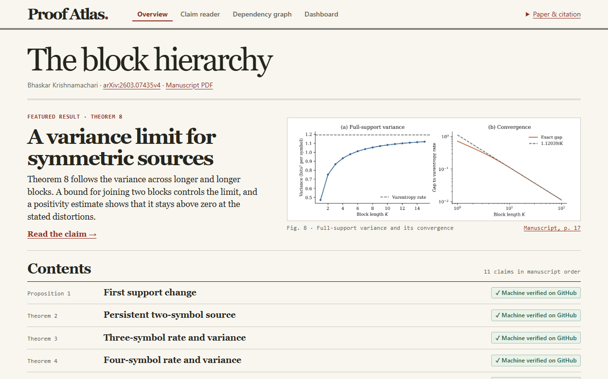

# Proof Atlas

Proof Atlas is a skill for turning a mathematics paper into a website where readers can follow a theorem from its manuscript statement to its Lean proof and inspect the evidence that the proof checked. The explorer and progress dashboard are available from the first build and update as the formalization advances. [Explore a finished atlas](https://anrgusc.github.io/markov-block-hierarchy-proof-atlas/).

## Try it on a real theorem

Bhaskar Krishnamachari’s *A Block Hierarchy for Rate-Distortion and Dispersion of Binary Markov Sources*, arXiv:2603.07435v4 [cs.IT], 19 November 2026, has eleven inventoried claims. Ten are proved results with GitHub verification records. The remaining claim is an open conjecture about operational dispersion. [Paper on arXiv](https://arxiv.org/abs/2603.07435v4) · [Paper-specific proof repository](https://github.com/ANRGUSC/markov-block-hierarchy-proof-atlas).

| What you want to know | Where to look |
| --- | --- |
| What does Theorem 8 establish? | Read the plain-English explanation of the variance limit, then open the original statement on page 19. [Plain English](https://anrgusc.github.io/markov-block-hierarchy-proof-atlas/proofs/index.html#/claim/thm%3Acommon?view=english) · [Paper](https://anrgusc.github.io/markov-block-hierarchy-proof-atlas/proofs/index.html#/claim/thm%3Acommon?view=paper) |
| How does the proof work? | Follow the structured Lamport proof from the one-cut estimate through the dyadic limit and the return to fixed distortion. [Lamport proof](https://anrgusc.github.io/markov-block-hierarchy-proof-atlas/proofs/index.html#/claim/thm%3Acommon?view=lamport) |
| Which other results does it use? | Follow the arrows from Lemma 7 and Corollary 9 into Theorem 8. **Selected chain** follows its prerequisites and dependents. **Whole paper** includes every claim, even those with no recorded edges. [Dependency graph](https://anrgusc.github.io/markov-block-hierarchy-proof-atlas/proofs/index.html#/graph/thm%3Acommon) |
| What did Lean actually check? | Open the formal declaration and its audit. The green badge leads to the GitHub run that rebuilt it. The public record identifies the commit, declaration, expected statement, and axioms. [Lean view](https://anrgusc.github.io/markov-block-hierarchy-proof-atlas/proofs/index.html#/claim/thm%3Acommon?view=lean) · [Verification run](https://github.com/ANRGUSC/markov-block-hierarchy-proof-atlas/actions/runs/44775699155/attempts/1) · [Verification record](https://anrgusc.github.io/markov-block-hierarchy-proof-atlas/logs/lean-verification.json) |
| How much of the paper is done? | The dashboard lists each claim, its status, the authorized scope of work, and available evidence. During formalization it can also show which claim is being written or checked. [Progress dashboard](https://anrgusc.github.io/markov-block-hierarchy-proof-atlas/progress.html) |

## Use it with your paper

Give your coding agent the [build-proof-atlas skill](build-proof-atlas/SKILL.md), a versioned arXiv link or manuscript sources, and a stopping point. For example:

> Use build-proof-atlas on this paper: [versioned arXiv URL]. Build the explorer and dashboard, then formalize the stated results in Lean. Continue through the whole paper, track conjectures separately, and ask me where to host the atlas.

For a smaller first pass, name one theorem and ask the agent to stop after checking it and its prerequisites.

1. **Bind the edition.** The agent checks the title, authors, TeX and PDF, inventories claims in manuscript order, and links them to source passages. It reviews dependencies and records where proof material is still missing.
2. **Open the atlas.** The Folio homepage pairs a featured result with a manuscript figure when one is available. **Paper & citation** holds the full citation and reading guide. The claim reader and dashboard rebuild as checkpoints change.
3. **Generate and check proofs.** The agent locates or provisions the pinned Lean toolchain, reuses relevant checked lemmas, and splits substantial independent obligations where that helps. It checks the assembled declaration against the intended statement and audits its axioms. **Subproofs checked** means work remains on the parent theorem.
4. **Approve the statements.** A claim closes only after the author reads its Lean statement and definitions and approves them with `atlas.py approve` in their own terminal. **Statement approved by <author>** is shown next to **Lean checked** and is withdrawn automatically if the statement or a definition it uses changes.
5. **Choose how to share it.** Keep the atlas local or choose a GitHub repository and GitHub Pages. GitHub verification is a separate opt-in. **Lean checked** identifies a locally audited claim. **Machine verified on GitHub** links to an independent check of that claim at the published revision.

The reusable renderer and workflows live in this repository. Each paper keeps its manuscript, Lean sources, checkpoints, and evidence in its own project. [Skill instructions and setup commands](build-proof-atlas/SKILL.md).

## Credits

Scott Moeller and Bhaskar Krishnamachari created Proof Atlas.
